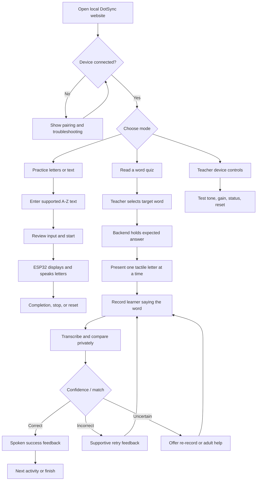

# DotSync Web App Flow

**Status:** Draft for implementation planning

## 1. Main navigation

## 2. Practice flow

1. Website checks the local backend and ESP32 health/status.
2. Teacher selects Practice and enters A-Z letters/words. The site rejects unsupported symbols with an explanation.
3. Site announces the submitted text and requests confirmation to start.
4. Backend posts to the ESP32 `/api/learn` route and tracks device status. It handles queued (`202`), busy (`409`), timeout, and disconnect states.
5. The ESP32 cycles the single Braille cell through letters and plays the matching recorded letter name.
6. Site announces completion and offers another activity, replay, or reset.

## 3. Word quiz flow

1. Teacher selects a short word from a curated list or enters an A-Z word.
2. Backend creates a session and keeps the expected word out of learner-facing API responses.
3. Backend sends each target letter to `/api/quiz/show` as the learner progresses. The current firmware endpoint takes one letter at a time.
4. The agreed advance control moves to the next letter. For MVP this may be teacher-controlled; independent touch-based advancement requires additional hardware because no touch sensor is present.
5. Learner requests a recording. Backend queues `/api/quiz/record`, waits for capture to finish, then downloads `/api/mic.wav`.
6. Backend passes the audio to the transcription adapter. It normalizes transcript and compares against the private target.
7. Backend returns only outcome, transcript feedback appropriate for the learner, and a next action. For uncertain speech, offer another recording rather than a wrong-answer judgment.
8. Backend asks ESP32 to play the feedback tone if useful. Spoken prompts and sentences come from the computer/browser in the MVP because the hardware audio file contains only A-Z letter clips and tones.
9. Session ends; temporary audio is deleted.

## 4. Session states

`idle → connecting → ready → presenting → waiting_for_answer → recording → transcribing → feedback → next_item/completed`

Recoverable states: `device_busy`, `device_offline`, `recording_failed`, `transcription_uncertain`, `unsupported_input`, and `cancelled`. Every state must have a spoken/accessible message and a clear action such as retry, reconnect, skip with teacher help, or reset.

## 5. Safety and privacy rules in the flow

- Hide the target word and expected transcript from the learner view until the teacher chooses to reveal it.
- Do not start microphone recording without a clear prompt and visible/audible recording state.
- Do not save audio by default. Do not send audio to a third party without the configured disclosure and appropriate permission.
- Provide an adult exit/reset route; avoid requiring a child to solve connection errors alone.
